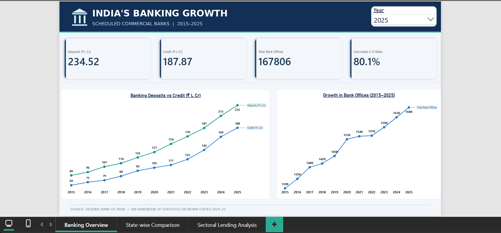
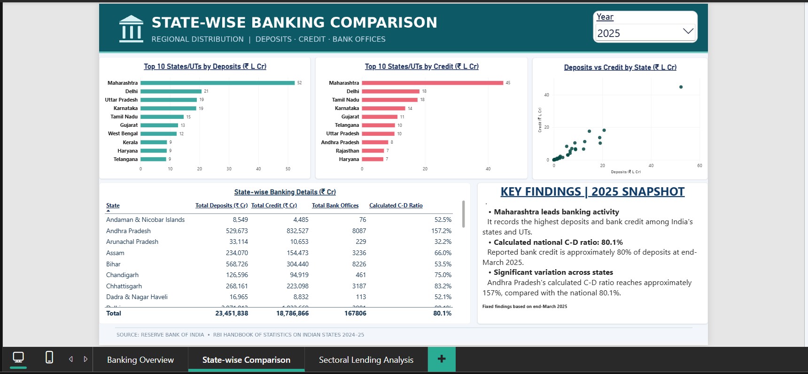
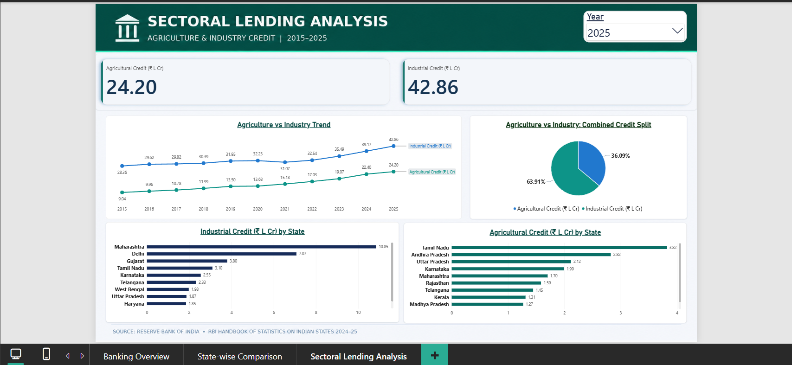

# India's Banking Landscape | Power BI Portfolio

**Banking growth, state-wise distribution and sectoral lending in India (2015–2025)**

An interactive **three-page Power BI report** exploring scheduled commercial banks' deposits, credit, bank-office counts and reported lending to agriculture and industry across Indian states and union territories. The analysis uses the Reserve Bank of India's *Handbook of Statistics on Indian States, 2024–25*.

**Tools:** Power BI Desktop · Power Query · DAX  
**Geography:** Indian states and union territories  
**Period:** End-March observations, 2015–2025  
**Reporting units:** ₹ lakh crore in overview charts; ₹ crore in detailed tables; offices as counts

## Dashboard preview

### 1. Banking Overview

Shows selected-year deposits, bank credit, calculated credit-to-deposit (C-D) ratio and bank-office counts. The two line charts retain the historical 2015–2025 trends when a year is selected for the KPI cards.

### 2. State-wise Comparison

Compares the top 10 states/UTs by deposits and credit, state-level deposits versus credit, and individual state figures. The *2025 Key Findings* text is a fixed snapshot and does not change with the year slicer.

### 3. Sectoral Lending Analysis

Compares reported agricultural and industrial credit outstanding, their trends and the leading states/UTs. The pie chart shows each sector's share **of the combined agricultural-plus-industrial credit amount**, not its share of total bank credit.

## Key findings

| Indicator | End-March 2015 | End-March 2025 | Change |
|:--|--:|--:|--:|
| Bank deposits | ₹89.22 lakh crore | ₹234.52 lakh crore | +162.9% |
| Bank credit | ₹68.78 lakh crore | ₹187.87 lakh crore | +173.1% |
| Bank offices | 130,482 | 167,806 | +28.6% |
| Calculated C-D ratio | 77.1% | 80.1% | +3.0 percentage points |
| Agricultural credit | ₹9.04 lakh crore | ₹24.20 lakh crore | +167.7% |
| Industrial credit | ₹28.36 lakh crore | ₹42.86 lakh crore | +51.1% |

- **Bank credit grew slightly faster than deposits** over the period, while bank-office counts expanded more slowly than either balance.
- **Maharashtra** had the highest reported state/UT deposits, total bank credit and industrial credit in 2025.
- **Tamil Nadu** had the highest reported agricultural credit in 2025.
- Calculated state C-D ratios varied substantially: **Andhra Pradesh's ratio was approximately 157.2%** in 2025, compared with **80.1%** for the sum of the state/UT observations.

*Numbers are rounded from the completed Power BI report; growth rates use the displayed or previously checked values. They are descriptive, nominal comparisons, not causal or inflation-adjusted estimates. See [Findings](docs/FINDINGS.md) for further discussion.*

## Data sources

The project uses five tables from the RBI's **2024–25** *Handbook of Statistics on Indian States*:

| RBI table | Subject | Source unit |
|:--|:--|:--|
| 152 | Offices of scheduled commercial banks | Count |
| 155 | Deposits by scheduled commercial banks | ₹ crore |
| 156 | Credit by scheduled commercial banks | ₹ crore |
| 157 | Credit to agriculture | ₹ crore |
| 158 | Credit to industry | ₹ crore |

**Official source:** [Reserve Bank of India — Handbook of Statistics on Indian States](https://www.rbi.org.in/Scripts/AnnualPublications.aspx?head=Handbook%20of%20Statistics%20on%20Indian%20States).

RBI's credit-deposit ratio tables by **place of sanction** (153) and **place of utilisation** (154) were cleaned during development but were **not used in the final report**. The dashboard's calculated C-D ratio equals reported bank credit divided by deposits; it is not labelled as either separately published RBI ratio.

## Data preparation and Power BI model

1. Imported the **2015–2025 `(ii)` worksheets** from the five RBI Excel workbooks into Power Query.
2. Removed regional and all-India aggregate rows from state-level facts to prevent double counting.
3. Promoted headers, unpivoted year columns, standardised state labels and year types, and represented unavailable observations as `null` rather than deleting the corresponding State–Year records.
4. Checked that State–Year combinations were unique, then merged the five metric queries on **State + Year** into `Fact_Banking`.
5. Built measures for balances, counts, the calculated C-D ratio and conversion from **₹ crore to ₹ lakh crore** (divide by 100,000).

The combined fact table contains **407 State–Year records (37 labels × 11 years)** and seven columns before any geographic harmonisation. Some metric values are `null`.

For more details, see [Methodology](docs/METHODOLOGY.md).

## Analytical limitations

- All monetary figures are **end-March balances or amounts outstanding**, not new loans disbursed over the year. Balances from different years should not be summed as though they were annual flows.
- Beginning in 2020, RBI's **Dadra & Nagar Haveli** figures include **Daman & Diu**; that reporting change limits straightforward year-on-year comparisons for those territories. The project does not claim to have harmonised their boundaries.
- Missing or not-applicable observations are not automatically treated as zero.
- The agricultural/industrial pie-chart denominator covers **only those two reported sectors**, not total bank credit.
- These descriptive comparisons do not establish why banking indicators changed. Monetary growth is nominal and not inflation-adjusted.
- The original RBI Excel workbooks are **not included** in this repository. A refresh may require downloading the workbooks and updating local source paths in Power Query. A full independent cell-by-cell verification against every original sheet has not been documented.

See [Verification notes](docs/VERIFICATION.md).

## Open the Power BI report

1. [Download the Power BI file](dashboard/India_Banking_Portfolio_Final.pbix).
2. Open it in a compatible installation of **Power BI Desktop**.
3. Explore **Banking Overview**, **State-wise Comparison**, and **Sectoral Lending Analysis**. The screenshots above show **2025** selected.
4. To refresh the data, obtain the RBI source workbooks and update their file paths in **Power Query → Data source settings**, as necessary.

**Note:** The uploaded PBIX was checked for package integrity and the presence of three report pages, but a successful Desktop reopen and refresh must be confirmed within Power BI Desktop.
